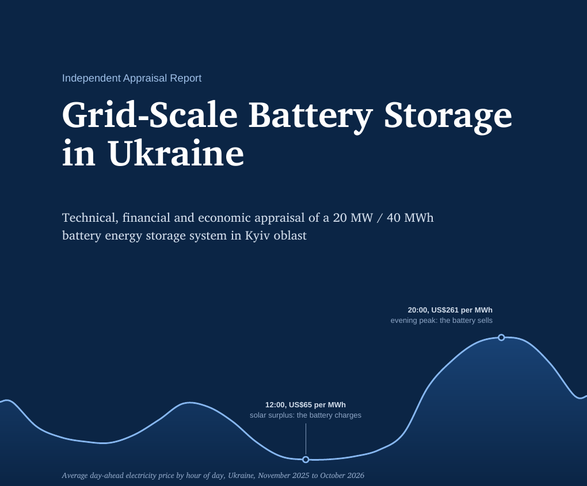
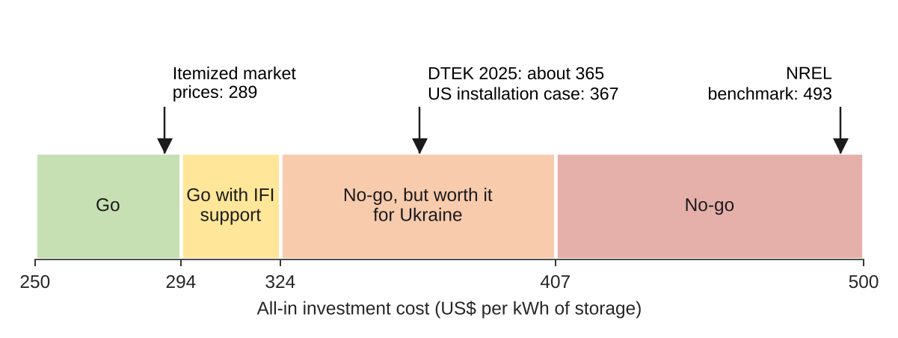
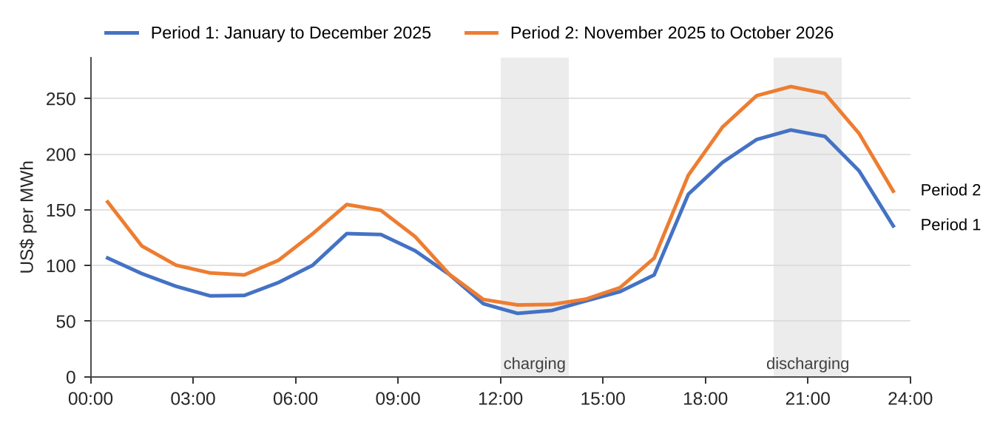

# Grid-Scale Battery Storage in Ukraine

An independent appraisal of a 20 MW / 40 MWh battery in Kyiv oblast, done the way the World Bank appraises a project: a technical basis, revenue from real hourly prices, a financial model for the investor and an economic model for the country.

**[Read the full report (PDF)](report/Ukraine-BESS-Appraisal-Report.pdf)**

## The answer in one picture

The battery earns about US$2.8 million a year. Whether it should be built depends on how much it costs to build.

| Cost estimate | All-in cost (US$ per kWh) | Equity IRR, best financing | Economic NPV at 6% | Decision |
|---|---:|---:|---:|---|
| NREL benchmark | 493 | 1.3% | −US$5.7 million | No-go |
| Market battery, US installation (close to DTEK's 2025 projects) | 367 | 9.4% | +US$2.5 million | No-go, but worth it for Ukraine |
| Itemized market prices | 289 | 22.8% | +US$7.3 million | Go |

Investors in Ukraine expect at least 15 percent on equity. At today's realistic cost the battery is good for the country but not for a private investor. The cheapest way to close that gap is a longer reserve contract from Ukrenergo, not a subsidy.

## How the battery earns money

Electricity in Ukraine is cheap at midday, when solar plants produce the most, and expensive in the evening. The battery buys at midday and sells in the evening. Ukrenergo also pays it to keep 10 MW ready to correct the grid frequency (aFRR, automatic frequency restoration reserve).

## How I worked

| When | What happened |
|---|---|
| Mid-October 2026 | Decided to do a finance project of my own on real data. I dropped my first idea, a model for one of my employer's sites, because I could not use that data freely |
| Late October | Visited the World Bank, which gave me most of my motivation for the project |
| 3 November | Chose a World Bank style appraisal of battery storage in Ukraine |
| 5 November | Collected 669 days of hourly prices from the Market Operator |
| 10 November | Moved the site from the Polish border to Kyiv oblast, connected to the regional grid at 35 kV |
| 17 November | Fixed the decision criteria before any calculation |
| 21 November | Technical basis, revenue analysis and financial model |
| 22 November | Market-price cost case and economic analysis |
| 23 November | Full report, revised after a review written from the point of view of a World Bank economist |

## What I found

- **Cheap batteries alone are not enough.** Battery containers became much cheaper in 2025, but with US installation costs the investor still earns only 9.4 percent.
- **The battery is worth more to Ukraine than to an investor.** At a realistic cost it adds US$2.5 million of value to the country while missing the investor's hurdle.
- **Contracts matter as much as prices.** Ukrenergo's reserve contracts last at most five years and pay only in set hours. If reserve is paid 12 hours a day instead of 24, even the cheapest case fails.

## Problems I ran into

I kept a record of every mistake I found and fixed (Annex 6 of the report). The main ones:

- The grid connection fee for storage changed in September 2026: storage now pays for both withdrawal and release capacity. My first estimate used only one rate.
- The widely quoted BNEF battery price does not include installation. My first market estimate missed this, so I rebuilt the cost item by item.
- I first counted every day with daytime charging as carbon-free. Only days with really cheap midday power should count.
- A review of the first draft showed that the base case relied on a reserve contract longer than any Ukrenergo offers. I added that test, switching values and a combined downside case.

## What is in this repository

| Folder | Content |
|---|---|
| [report/](report/) | The full appraisal report (PDF) |
| [docs/](docs/) | Working papers: concept note, technical basis, revenue, financial and economic analysis |
| [models/](models/) | Excel models with live formulas |
| [scripts/](scripts/) | Python: price data processing, arbitrage strategies, financial and economic models |
| [data/](data/) | Hourly market prices, raw and processed |

## Methods and tools

Python (pandas, NumPy) and Excel. Each Excel model was checked against the Python code for every combination of scenario, financing and cost case, with no differences. All data are public, and every number in the report is traced to a source.

I used an AI assistant (Claude, by Anthropic) to search for sources, write code, and draft and check documents. I set the question and the decision criteria, made the analytical choices and checked the results.

## Author

Mykyta Skyba, B.S. candidate in Electrical Engineering (Energy), The George Washington University.

*This is an independent analysis. It is not a World Bank Group document and is not affiliated with or endorsed by the World Bank Group. It is not investment advice.*
